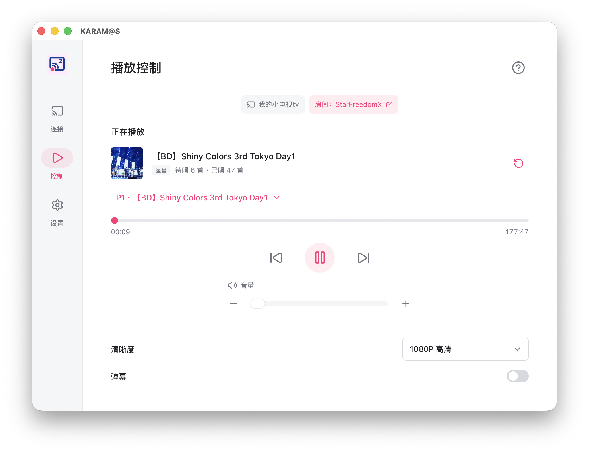

# KARAM@S

[下载应用](https://github.com/KARAOKE-MASTER-ZJU/karamas/releases/latest) / [开始使用](#开始使用) / [更新日志](CHANGELOG.md) / [问题反馈](https://github.com/KARAOKE-MASTER-ZJU/karamas/issues)

KARAM@S 是配合 [KTV Song List Web](https://github.com/KARAOKE-MASTER-ZJU/ktv-song-web) 使用的投屏播放器，支持同步房间歌单、播放当前歌曲，并在播放结束时自动切歌。

_投屏页预览_

## 功能

- **歌单同步与自动切歌**：同步房间的当前歌曲和歌单状态，歌曲播放结束时自动切歌。
- **播放方式**：支持本机播放、DLNA 投屏和哔哩哔哩小电视云投屏。
- **播放控制**：支持暂停、继续、切歌、进度和音量调节，以及清晰度和分 P 选择。

## 下载与安装

前往 [GitHub Releases](https://github.com/KARAOKE-MASTER-ZJU/karamas/releases/latest)，选择对应系统和处理器的安装包。

| 平台               | 安装包                | 如何选择                                                                                     |
| ------------------ | --------------------- | -------------------------------------------------------------------------------------------- |
| Windows            | `.exe`                | 常见 Intel / AMD 电脑选 `windows_x64`；ARM 电脑选 `windows_arm64`；32 位系统选 `windows_x86` |
| macOS              | `.dmg`                | Apple 芯片选 `darwin_aarch64`；Intel 芯片选 `darwin_x64`                                     |
| Linux              | `.AppImage` 或 `.deb` | 按处理器选择 x64 / amd64 或 arm64 / aarch64；Debian、Ubuntu 等系统也可使用 `.deb`            |
| Android 7.0 及以上 | `.apk`                | 常见手机选 `android-arm64-v8a`；其他架构可选 `armeabi-v7a`、`x86` 或 `x86_64`                |

## 开始使用

### 加入点歌房间

准备一个可用的 KTV Song List Web 点歌台网址。可以使用已有部署；如需自行搭建，参照[点歌台部署指南](https://github.com/KARAOKE-MASTER-ZJU/ktv-song-web#自行部署)。

打开 KARAM@S 的“连接”页，填写服务器网址和房间号。例如，网址填 `https://ktv.example.com`，房间号填 `karaoke`。已有房间选择“加入房间”，新房间选择“创建并加入”。

### 选择播放方式

| 方式         | 操作                             | 使用条件                                      |
| ------------ | -------------------------------- | --------------------------------------------- |
| 本机播放     | 在“其他”中开启“本地”             | 直接用当前电脑或手机播放视频和声音            |
| DLNA 投屏    | 在“DLNA”中搜索并连接设备         | 本机与电视连接同一网络，电视或接收端支持 DLNA |
| 小电视云投屏 | 在“小电视”中扫码登录，再选择设备 | 需要登录哔哩哔哩账号，并有可连接的小电视设备  |

### 快捷键

本机播放支持以下快捷键，输入文字时不会触发：

| 按键  | 操作             |
| ----- | ---------------- |
| 空格  | 播放 / 暂停      |
| ← / → | 快退 / 快进 5 秒 |
| ↑ / ↓ | 调整音量         |

## 常见问题

### 本项目和 [ktv-casting-android-app](https://github.com/KARAOKE-MASTER-ZJU/ktv-casting-android-app)是什么关系？

本项目是该项目的跨平台重构版，直接基于[ktv-casting](https://github.com/KARAOKE-MASTER-ZJU/ktv-casting)开发，减少维护两个仓库带来的不必要的麻烦。与此同时原有的两个仓库将不再进行更新。

### 为什么小电视模式显示切歌了却实际没成功？

这个是小电视的限制，可能请求返回成功但是设备仍然可能不播放，需要手动点一下重新投屏，未来会尝试优化。

### 为什么小电视的进度不同步？

小电视默认接收b站的主动消息推送来同步校准进度，大概10s一次，并且会有网络延迟，所以可能会出现不同步的情况。

### 纯k进度条为什么显示10小时？

因为纯k没法查到播放总时长，因此程序会自动查询视频时长。当查询失败时，会显示默认回退的10小时时长。

### 为什么无法搜索到 DLNA 设备

DLNA默认从可用的 IPv4 局域网接口搜索，检查一下网络是否和被投屏设备在同一局域网和广播域，检查局域网是否允许 SSDP 组播通信。

### DLNA 设备无法播放 HLS

DLNA 的“HLS 播放”是实验性选项，需要接收端支持。开启后如果出现播放或定位问题，可在“设置 → DLNA 投屏”中关闭，再重新投屏。

### 清晰度列表没有 1080P 60帧等清晰度

可能是视频本身没有提供、b站没有登录、未开启反向代理或HLS

### 如何反馈问题

在“设置 → 运行日志”中保存或分享日志，并在 [Issues](https://github.com/KARAOKE-MASTER-ZJU/karamas/issues) 中说明应用版本、操作系统、播放方式、设备型号和复现步骤。

## 应用更新

可以从 [Releases](https://github.com/KARAOKE-MASTER-ZJU/karamas/releases/latest) 下载新版覆盖安装。

支持应用内更新的版本，也可以在“设置 → 关于”中检查更新，下载完成后点击“安装并重启”。

## 参与开发

KARAM@S 基于 Tauri 2、Vue 3、TypeScript 和 Rust 构建。环境准备、源码运行、测试和打包说明见[开发指南](DEVELOP.md)，各版本变化见[更新日志](CHANGELOG.md)。

## 许可证

本项目采用 [MIT 许可证](LICENSE)。第三方依赖保留各自的许可证，详见[第三方许可证说明](THIRD_PARTY_NOTICES.md)。

## 致谢

- [KTV Song List Web](https://github.com/KARAOKE-MASTER-ZJU/ktv-song-web): 配套的网页点歌台。
- [ktv-casting](https://github.com/aspromise/ktv-casting)（作者 [aspromise](https://github.com/aspromise)）及其 [KARAOKE-MASTER-ZJU 分支](https://github.com/KARAOKE-MASTER-ZJU/ktv-casting): 本项目投屏核心的来源。
- [hls.js](https://github.com/video-dev/hls.js): 本机播放器的 HLS 播放支持。
- [rupnp](https://github.com/jakobhellermann/rupnp) 及其 [aspromise 分支](https://github.com/aspromise/rupnp): DLNA 设备描述解析与 UPnP 服务访问。
- [innertube-rs](https://github.com/caya8205-2/innertube-rs): YouTube 媒体信息获取与播放地址解析。
- [mp4-rust](https://github.com/alfg/mp4-rust): MP4 元数据与时长读取。
- [bilikara](https://github.com/VZRXS/bilikara): 本地/有线投屏客户端，本项目参考了实现
