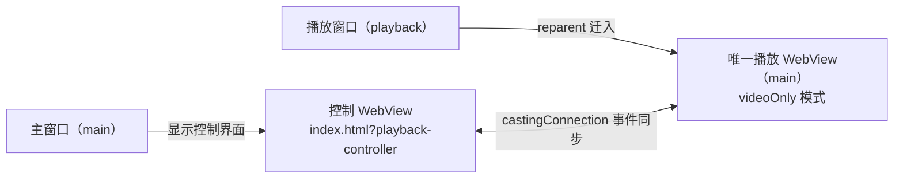

# 应用层架构

`app/` 包含 Vue 3 前端（`src/`）与 Tauri 接入层（`src-tauri/`），负责界面交互、原生命令桥接、窗口管理及平台能力接入；投屏核心逻辑位于[核心库架构说明](../karamas_core/DEVELOP.md)。环境准备、构建和检查命令见根目录[开发说明](../DEVELOP.md)。

## 前端分层与约定

```text
src/
├── pages/        # 页面编排，不直接调用 Tauri IPC
├── components/   # 展示与交互组件，优先通过 props 和 emit 通信
├── composables/  # 轮询、快捷键、媒体查询和布局等副作用逻辑
├── stores/       # Pinia 状态（连接会话、播放输出、偏好、登录、日志、更新）
├── services/     # 集中封装 Tauri invoke / listen 及平台能力
└── types/        # 前后端共享的数据结构定义
```

开发时需遵守以下边界：

- **原生调用收敛在 `services/`**：所有 `invoke` 和事件订阅集中在 `src/services/`（核心投屏命令在 `casting.ts`），页面和组件不直接拼命令名。`isTauri()` 为 `false` 时，服务层拦截原生调用或返回降级值，保证浏览器预览可用。
- **统一错误处理**：Tauri 命令失败统一返回 `{ code, message }`（`CommandError`），前端经 `errorMessage()` 提取文案，通过 `useOperationNotice` 弹出 Toast。
- **播放状态轮询与防竞态**：`useCastingRuntime` 每秒轮询 `poll_playback`（只读核心库缓存）并转发后台歌单同步错误。`useCastingStore` 通过递增 `revision` 丢弃过期的轮询回包，新增会改变播放状态或会话的控制方法时需维护该计数。
- **`PlaybackPage` 常驻文档**：`App.vue` 通过 `v-show` 控制 `PlaybackPage` 可见性而不销毁组件，确保切换页面时本机 `<video>` 元素和播放不断开。

## 本机播放输出与双 WebView

本机播放支持内嵌、独立窗口（仅桌面端）和外接显示器全屏，并支持多屏编号识别。为避免切换输出时中断视频播放，桌面端采用搬移文档而非重建播放器的方式：



- **切出内嵌**：`platform/playback_output/desktop.rs` 先通知 `main` WebView 进入 `videoOnly` 模式，再将其 `reparent` 到 `playback` 窗口；同时在主窗口加载 `index.html?playback-controller`（`isPlaybackController === true`）继续提供控制界面。
- **跨文档同步**：`services/castingConnection.ts` 只同步连接选择、本机播放命令标识和本机播放器回传；播放状态和媒体信息仍各自直接来自核心库。播放文档不订阅自己发出的回传事件，避免 macOS 派发事件时清除用户激活状态。
- **开发注意**：改动本机播放、偏好恢复或连接状态时，需确认 `isPlaybackController` 与 `videoOnly` 两条路径，避免在控制文档中创建第二个播放器或遗漏跨文档状态同步。

## Tauri 接入层（`src-tauri/`）

```text
src-tauri/src/
├── lib.rs            # 应用初始化、插件注册与退出清理
├── state.rs          # BridgeState 及 current_engine()
├── error.rs          # CommandError 与核心错误映射
├── commands/         # Tauri 命令转发层
├── platform/         # 桌面/Android 多屏、播放输出、分享与 Android 插件桥接
├── session_store/    # 哔哩哔哩登录会话加密存储与旧文件迁移
├── logging/          # 日志缓冲、文件落盘、panic 记录与导出
└── updater/          # 桌面与 Android 更新检查和安装
```

接入层维护以下约束：

- **命令层只做转发**：`commands/` 只处理参数转换、调用 `karamas_core` 或平台模块和错误映射，不在此处堆叠投屏逻辑。新增命令需在 `commands/mod.rs` 注册并在 `app/src/services/` 暴露对应方法。
- **状态与锁边界**：`BridgeState` 只保存接入协调状态（`lifecycle` 串行化启停、`login` 扫码取消句柄、`session_io` 串行化会话读写、延迟初始化的目录与诊断播放器），不缓存播放状态。执行异步命令前先通过 `current_engine()` 克隆 `Arc<EngineContext>` 再释放全局状态锁。
- **退出清理**：`RunEvent::Exit` 回调中调用 `karamas_core::reset_engine()`、取消进行中的扫码任务并刷新日志，不阻塞等待异步锁。

## 平台差异与存储

- **登录凭据存储**：`session_store/` 将哔哩哔哩会话加密写入应用私有数据目录，并自动迁移删除旧明文文件；读写操作通过 `BridgeState.session_io` 串行化。
- **Android 接入**：`platform/android.rs` 通过 `CastingPlatformPlugin` 桥接网络与组播访问、外接屏管理、应用内 APK 安装和返回键切后台。Android 原生工程位于 `src-tauri/gen/android`，与源码共同维护。
- **应用内更新**：桌面端使用 `tauri-plugin-updater` 配合 `latest.json`，Android 端读取 `android-update.json` 后交由原生插件拉起安装；更新源配置与测试见[发布说明](../docs/RELEASE.md)。
