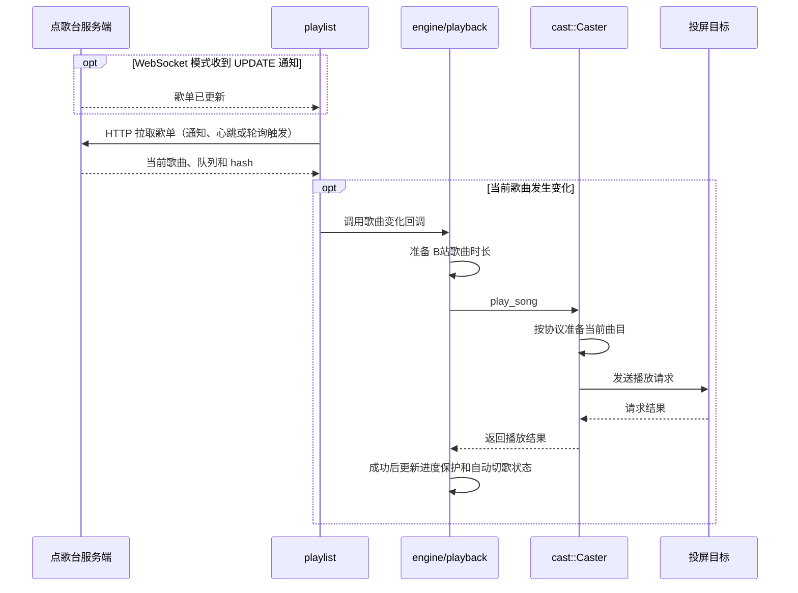
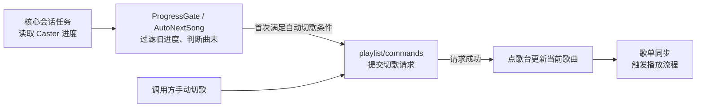
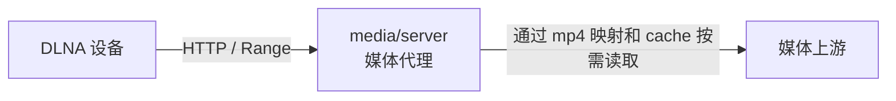

# 核心库运行架构

核心库当前由 `ENGINE_STATE` 保存一个活动会话。调用方持有 Tokio 运行时，将 `Handle` 传给引擎；引擎组合房间同步、设备控制和媒体服务。

## 房间同步与播放

播放流程从歌单同步开始。WebSocket 通知、心跳和 HTTP 轮询都通过同一条同步路径检查当前歌曲。



`Caster` 根据会话使用 `DlnaCaster` 或 `BilibiliCaster`。暂停、音量和定位等控制由引擎直接调用对应的设备接口。

## 进度与切歌

会话在宿主提供的 Tokio 运行时上每秒查询一次进度，并驱动自动切歌，断开时取消任务。DLNA 查询设备进度，B站云投屏读取回传校正后的本地进度；查询串行执行，错过的周期不补发。

下图表示处理顺序。切歌请求完成后，由下一次歌单同步触发播放，对应上图的流程。



`get_current_progress()` 和 `EngineContext::playback_state()` 只读缓存，不查询设备或触发切歌。查询失败时保留上次有效进度；切歌或重新投屏时清除旧进度。自动切歌只使用本轮取得并通过过滤的进度，在一次播放期间只触发一次，播放成功确认后才重新启用。

宿主无须另启设备进度查询或自动切歌任务。新增控制命令时，需要让操作前发出的查询失效，并保留歌曲播放确认的版本。

## DLNA 媒体传输

代理模式下，`DlnaCaster` 先通过 `media/session` 和 `sources` 准备当前曲目，再将本地媒体地址发给设备。DASH 媒体会预先构建 MP4 索引，并创建分块缓存。

下图中的箭头表示拉流请求方向。控制指令和媒体字节通过不同路径传输。



- **代理模式：** 本地代理转发直链媒体，或通过 MP4 索引和分块缓存提供 DASH 媒体；缓存命中时不需要请求上游。
- **直连模式：** 设备直接访问媒体上游，媒体字节不经过本地代理。
- **B站云投屏：** `BilibiliCaster` 通过投屏控制 API 下发歌曲信息，不经过本地媒体代理。

## 小电视状态回传

`cast/bilibili/broadcast` 通过 gRPC 连接 `broadcast.chat.bilibili.com:7824`，调用 `BroadcastTunnel/CreateTunnel`，鉴权后订阅 `Tv/Proj` 和 `Tv/ProjCore`。HTTP 负责下发控制命令，gRPC 回传用于同步进度和播放状态；订阅失败不阻塞播放。断开引擎时关闭订阅，广播断流后在下次播放时重连。

关键参数：

- `extra.buvid` 与 gRPC metadata 的 `buvid` 一致，指定回传接收端。发送端标识保存在 Tauri 应用偏好配置的 `bilibiliBuvid` 字段，桌面端和 Android 端的登录与投屏都复用该标识；`ott_buvid` 是目标电视标识。
- `extra.bizSessionId` 每次播放重新生成，用于关联当前曲目、过滤旧会话回传。
- HTTP 播放使用顶层 `cid`、`video_type=4`，以及 `extra.oid=aid`、`extra.type=101`。

回传中 `cmd=4` 为进度（秒），`5/6/7` 为暂停、恢复和停止，`13` 为时长（毫秒）。进度在回传间隔内按本地时钟推进，收到回传后校正。自动切歌仍由现有歌单逻辑处理。

调用方通过 `start_bilibili_engine_core` 的 `sender_buvid` 参数传入持久化的发送端标识。调试日志位于 `BILI_BROADCAST`，级别为 `debug`。以下实机诊断示例从环境变量 `BILIBILI_BUVID` 读取发送端标识，要求账号下只有一台在线设备，会从头投放指定曲目，监听 40 秒后退出，电视继续播放：

```bash
BILIBILI_BUVID=发送端标识 cargo run -p ktv-casting --example bilibili_broadcast_probe -- /path/to/bili_session.json BV号-page0
```

## 会话结束

`reset_engine()` 移除当前引擎，取消受跟踪任务和待处理的自动切歌请求，并通知本地媒体服务停止。调用方的 Tokio 运行时继续由调用方管理。
