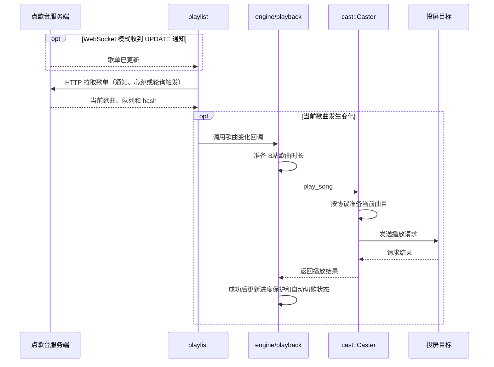
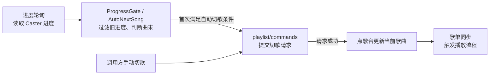
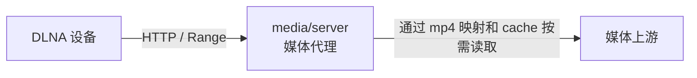

# 核心库运行架构

核心库当前由 `ENGINE_STATE` 保存一个活动会话。调用方持有 Tokio 运行时，将 `Handle` 传给引擎；引擎组合房间同步、设备控制和媒体服务。

## 房间同步与播放

播放流程从歌单同步开始。WebSocket 通知、心跳和 HTTP 轮询都通过同一条同步路径检查当前歌曲。



`Caster` 根据会话使用 `DlnaCaster` 或 `BilibiliCaster`。暂停、音量和定位等控制由引擎直接调用对应的设备接口。

## 进度与切歌

调用方定期调用 `poll_playback_progress()`。DLNA 查询设备进度，B站云投屏读取本地计时；进度过滤和曲末判断在查询后进行。

下图表示处理顺序。切歌请求完成后，由下一次歌单同步触发播放，对应上图的流程。



`get_current_progress()` 只查询和过滤进度，不触发自动切歌。自动切歌在一次播放期间只触发一次，播放成功确认后才重新启用。

## DLNA 媒体传输

代理模式下，`DlnaCaster` 先通过 `media/session` 和 `sources` 准备当前曲目，再将本地媒体地址发给设备。DASH 媒体会预先构建 MP4 索引，并创建分块缓存。

下图中的箭头表示拉流请求方向。控制指令和媒体字节通过不同路径传输。



- **代理模式：** 本地代理转发直链媒体，或通过 MP4 索引和分块缓存提供 DASH 媒体；缓存命中时不需要请求上游。
- **直连模式：** 设备直接访问媒体上游，媒体字节不经过本地代理。
- **B站云投屏：** `BilibiliCaster` 通过投屏控制 API 下发歌曲信息，不经过本地媒体代理。

## 小电视状态回传

`cast/bilibili/broadcast` 通过 TLS 连接 `broadcast.chat.bilibili.com:7824`，在 `BroadcastTunnel/CreateTunnel` 双向流上完成 Auth，并分别订阅 `Tv/Proj` 和 `Tv/ProjCore`。引擎启动时在后台建立订阅，播放直接发送 HTTP 命令，不等待订阅就绪。连接、鉴权、订阅失败或 15 秒握手超时只记录日志，不影响房间连接和播放。每次播放会检查后台任务，任务已退出时重新发起订阅。

发送端 buvid 保存在应用现有的持久化配置 `ktv-casting.preferences.v1` 的 `bilibiliBuvid` 字段中。扫码登录时生成并保存，投屏时复用；退出账号不清除这个字段。当前使用随机生成的安装标识。登录请求、广播 metadata、HTTP 命令的 `extra.buvid` 和 `device_info.pink_buvid` 共用这个值，由应用传入核心库。

CLI 和实机检查示例通过环境变量 `BILIBILI_BUVID` 接收发送端标识。JNI 的登录和投屏入口增加 `sender_buvid` 参数，由宿主从自己的持久化配置传入。

目标电视使用设备列表中的 `ott_buvid`。播放参数采用普通 UGC 格式，顶层传 `aid`、`cid` 和 `video_type=0`，`extra.type=0`。每次播放生成新的 `bizSessionId`，广播接收端据此过滤旧会话消息，并校验消息中提供的 aid、cid。buvid 持久化仅保持发送端身份，当前播放会话仍保存在内存中。

接收循环每 25 秒发送 Heartbeat，按服务端要求回复 MessageAck；订阅、ACK 和心跳通过同一发送者串行发送。`-bin` metadata 使用原始 protobuf 字节，由 tonic 编码。协议字段子集保存在 `broadcast/proto.rs`，字段编号与参考 Go 项目附带的 protobuf 对应，构建时无需 protoc。

当前只将有效回传写入 `BILI_BROADCAST` 的 `debug` 日志：`cmd=4` 为位置，`5/6` 为暂停和恢复，`7` 为停止，`13` 为时长。位置单位是秒，时长单位是毫秒，缺失时长保留为未知。界面进度、本地播放状态和自动切歌仍使用原有逻辑，`hardware_progress` 保持 `false`。

断开引擎会取消广播连接。握手超时也会清理后台任务。广播流异常退出后，下次播放会重新连接；当前尚未加入后台自动重连。

桌面环境可用以下命令单独检查回传。该命令会开启 `BILI_BROADCAST` 的 `debug` 日志，要求账号下只有一台在线设备，会从头投放指定曲目，监听 40 秒后关闭广播连接，电视继续播放。确认日志里出现“电视状态回传”，不能只以 HTTP 播放命令成功判断链路正常。

```bash
BILIBILI_BUVID=发送端标识 cargo run -p ktv-casting --example bilibili_broadcast_probe -- /path/to/bili_session.json BV号-page0
```

2026-10-23 已用当前 Rust 实现完成实机验证：收到同一播放会话的 0、9、19、29 秒进度、恢复播放通知和 2606466 毫秒时长，监听结束后正常关闭广播连接。

## 会话结束

`reset_engine()` 移除当前引擎，取消受跟踪任务和待处理的自动切歌请求，并通知本地媒体服务停止。调用方的 Tokio 运行时继续由调用方管理。
