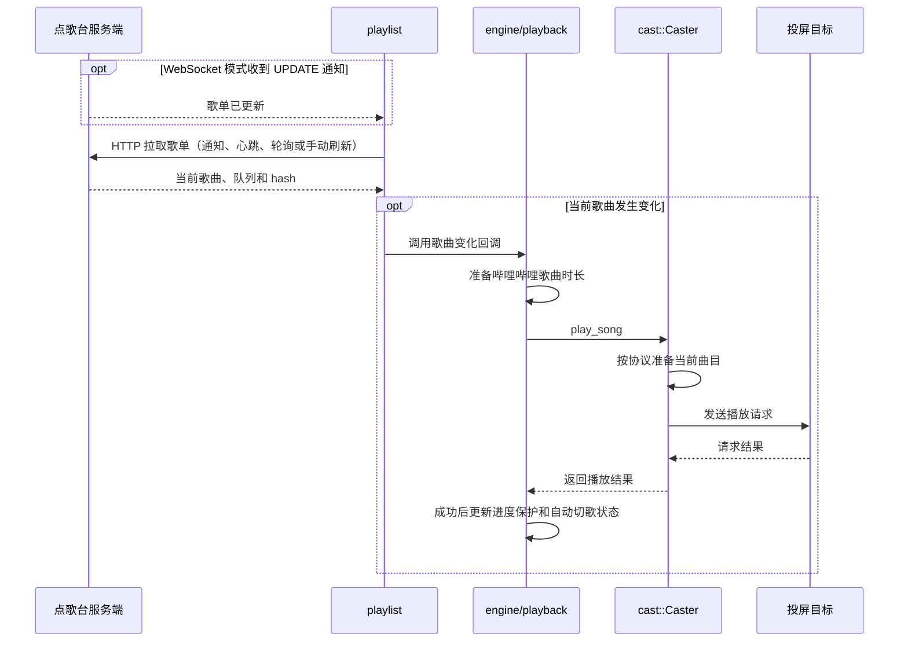
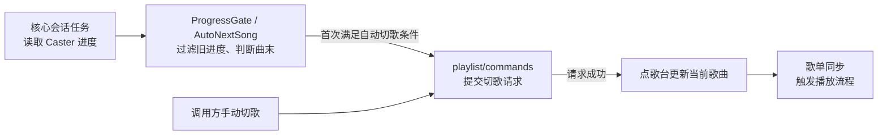

# 核心库运行架构

核心库当前由 `ENGINE_STATE` 保存一个活动会话。调用方持有 Tokio 运行时，将 `Handle` 传给引擎；引擎组合房间同步、设备控制和媒体服务。宿主在发起网络请求前须先安装 Rustls crypto provider（例如在应用启动时初始化）。

## 房间同步与播放

播放流程从歌单同步开始。WebSocket 通知、心跳、HTTP 轮询和手动刷新（`EngineContext::refresh_playlist()`）都通过同一条同步路径检查当前歌曲并共用去重状态；手动刷新的错误直接返回给调用方，不写入后台同步错误。



`Caster` 根据会话使用 `DlnaCaster`、`BilibiliCaster` 或 `LocalCaster`。暂停、音量和定位等控制由引擎调用对应接口；`LocalCaster` 通过宿主与本机播放器交互，操作及状态回传携带会话标识和操作编号。

## 进度与切歌

会话在宿主提供的 Tokio 运行时上运行三个每秒任务（设备播放状态刷新、进度采样与自动切歌、音量刷新），均串行执行、错过的周期不补发，断开时取消。

- **DLNA 与哔哩哔哩云投屏**：基于 `PlaybackTimeline` 本地走条，按回传校正。DLNA 定时查询设备进度，按播放版本和媒体 URI 校验并检测设备侧暂停；哔哩哔哩云投屏通过广播回传校正。
- **本机播放**：直接读取播放器回传的实际进度与状态。

下图表示处理顺序。切歌请求完成后，由下一次歌单同步触发播放，对应上图的流程。



`get_current_progress()` 和 `EngineContext::playback_state()` 只读缓存，不查询设备或触发切歌。查询失败时保留上次有效进度；切歌或重新投屏时清除旧进度。自动切歌只使用本轮取得并通过过滤的进度，在一次播放期间只触发一次，播放成功确认后才重新启用；直播流不展示总时长，也不触发自动切歌。

宿主无须另启设备进度查询或自动切歌任务。新增控制命令时，需要让操作前发出的查询失效，并保留歌曲播放确认的版本。

## 媒体传输

清晰度名称前的标记表示播放方式，均不转码：

- `[MP4]`：使用现成的单文件视频。
- `[DASH]`：将分离的音视频合并为 MP4，开播前需扫描整片分片头，长视频等待较久。
- `[HLS]`：按需加载音视频分片，无须扫描整片分片头，需要播放器支持。

| 播放模式 | 可选方式 | 媒体走向 |
| --- | --- | --- |
| 本地播放器 | MP4、DASH、HLS | 经本机代理播放 |
| DLNA 开启反代 | MP4、DASH；开启 HLS 开关后增加 HLS | 经本机代理传给设备 |
| DLNA 关闭反代 | MP4；开启 HLS 开关后增加 HLS | 点播由设备直连上游（HLS 清单由本机提供）；直播固定经本机代理 |

实验性功能“HLS 播放”只控制 DLNA，本地播放器不受影响。开关变更在下次切歌或重新投屏时生效。

DLNA 和本地播放器的新会话默认偏好 720P MP4，优先保留当前播放方式并在不高于目标档位中选最高档；无候选时按 MP4 → DASH → HLS 回退，临时回退不改写已保存的偏好。HLS 复用 DASH 音视频轨道，但以独立的 `hls` 标识参与模式选择（缺少分段信息的轨道不列入 HLS 候选）。

哔哩哔哩 MP4 和 DASH 在取源时选择可用 CDN；由 DASH 转换的 HLS 在清单准备和代理播放期间支持重试、备用 CDN 切换和媒体地址刷新。HTTP 媒体类型由核心库按响应内容识别，本机播放器据此分别交给原生播放器、hls.js 或 mpegts.js 播放。声音偏移由媒体代理处理，供本机播放和 DLNA 代理投屏使用。

哔哩哔哩云投屏由设备自行取流，不经过本机媒体代理。

## 网页遥控

网页遥控与歌单同步共用房间 WebSocket 连接，由引擎执行播放控制并回传状态。遥控可在当前会话中动态启停。歌单同步和起播串行执行，媒体准备期间仍可处理遥控消息。

## 小电视状态回传

`cast/bilibili/broadcast` 通过 gRPC 连接 `broadcast.chat.bilibili.com:7824`，鉴权后订阅 `Tv/Proj` 和 `Tv/ProjCore`。HTTP 负责下发控制命令，gRPC 回传用于同步进度和播放状态；订阅失败不阻塞播放。断开引擎时关闭订阅，广播断流后在下次播放时重连。

关键约束：

- `extra.buvid` 与 gRPC metadata 的 `buvid` 必须一致，用于指定回传接收端。调用方通过 `start_bilibili_engine_core` 的 `sender_buvid` 传入持久化标识（Tauri 应用保存在偏好配置的 `bilibiliBuvid` 字段，桌面端与 Android 端的登录和投屏共用）；`ott_buvid` 为目标电视标识。
- `extra.bizSessionId` 每次播放重新生成，用于关联当前曲目、过滤旧会话回传。具体协议字段与指令编号见 `src/cast/bilibili/broadcast/`。

调试日志目标为 `BILI_BROADCAST`，级别为 `debug`。以下实机探针从环境变量 `BILIBILI_BUVID` 读取发送端标识，要求账号下只有一台在线设备，会从头投放指定曲目，监听 40 秒后退出，电视继续播放：

```bash
BILIBILI_BUVID=发送端标识 cargo run -p karamas_core --example bilibili_broadcast_probe -- /path/to/bili_session.json BV号-page0
```

## 会话结束

`reset_engine()` 移除当前引擎，取消受跟踪任务和待处理的自动切歌请求，并通知本地媒体服务停止。调用方的 Tokio 运行时继续由调用方管理。
